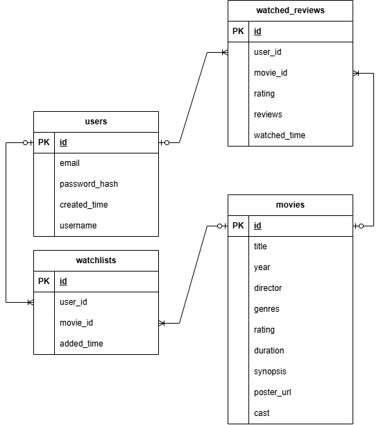

# GDGoC Recruitment Task: Movie Watchlist API

This repository contains the core backend files, along with the frontend files and data provided in the original starter pack.

This platform allows users to browse movie listings, manage watchlists, and log watched films with ratings and reviews. It also features an integrated Google Gemini AI to provide personalized movie recommendations.  

## LIVE DEPLOYMENT AND DELIVERABLES
- **Frontend App:** https://gdgoc-film-log.vercel.app
- **Backend API / Swagger UI:** https://gdgoc-filmlog-backend.vercel.app/docs
- **Video Walkthrough:** https://drive.google.com/file/d/1YfIBRfaoAiVOxLIkY6Z5yMEqy9JkWeP0/view

## TECH STACK
- **Backend:** Python, FastAPI, SQLAlchemy
- **Database:** PostgreSQL (Supabase)
- **Authentication:** JWT (JSON Web Tokens) & bcrypt (passlib)
- **AI Integration:** Google Gemini API (Gemini 3.5 flash lite)
- **Frontend:** HTML, CSS, JavaScript
- **Deployment:** Vercel

## PROJECT STRUCTURE

```text
├── backend/                 # Core FastAPI application
│   ├── routers/             # API route handlers (auth, movie, watch)
│   ├── services/            # Business logic (AI recommendations, auth services)
│   ├── database.py          # Database engine and session configuration
│   ├── dependencies.py      # FastAPI dependencies: auth guards, get_db
│   ├── main.py              # App instance and CORS
│   ├── models.py            # SQLAlchemy ORM models
│   ├── schemas.py           # Pydantic models for data validation
│   └── utils.py             # Helper functions (password hashing, etc.)
├── data/                    # Initial seed data from starter pack
│   ├── movies.json
│   └── seed.sql
├── frontend/                # Frontend from starter pack (Only the API URL is changed)
│   ├── app.js
│   ├── index.html
│   └── README.md
├── .env                     # Environment variables (Ignored in Git)
├── index.py                 # Vercel serverless entry point
├── requirements.txt         # Python project dependencies
├── vercel.json              # Vercel deployment conf
└── README.md                # Main project documentation     <-- You Here!
```

## 🗄️ Database Architecture (ERD)


---

## >> LOCAL SETUP AND INSTALLATION INSTRUCTION

Follow these instructions to run the API locally. 

### 1. Prerequisites
- **Python 3.9+** installed on your system
- **Git** to clone the repository
- A running **PostgreSQL** database (e.g., Supabase, local PostgreSQL, or MySQL/SQLite alternative)

### 2. Environment Variables
Create a `.env` file in the root directory of the project. You must configure the following variables:

```env
DATABASE_URL=postgresql+psycopg://[user]:[password]@[host]:5432/[db_name]
SECRET_KEY=your_super_secret_jwt_key
GEMINI_API_KEY=your_google_gemini_api_key
```

### 3. Install Dependencies
Open your terminal and install the required Python packages:

```bash
pip install -r requirements.txt

```

### 4. Migration / Seeder Command (Optional, read the Note)
*Note: If you are evaluating this project and already have the pre-seeded GDGoC database configured in your `.env`, you can skip this step. SQLAlchemy will automatically connect to your existing tables.*

If you are setting up a fresh database, run the following command to execute the table migrations and seed the initial 20-movie dataset from the starter pack:

```bash
# Execute this python script to migrate tables and seed data
python backend/seed.py

```

### 5. How to Run the App
Start the FastAPI development server using Uvicorn:

```bash
uvicorn backend.main:app --reload

```

The API will be available at `http://localhost:8000`. You can access the fully interactive API documentation (Swagger UI) at `http://localhost:8000/docs`

---

## CORE API ENDPOINT
**A. Authentication**
* `POST /api/auth/register` - Registers a new user (password is securely hashed)
* `POST /api/auth/login` - Authenticates user and returns JWT token

**B. Movies (Discover)**
* `GET /api/movies` - Returns a list of all movies in the catalog
* `GET /api/movies/{id}` - Returns single movie detail
* `POST /api/movies/recommend` - **[Gemini AI]** Takes user mood/prompt and recommends a movie strictly grounded to the existing database

**C. Watchlist (Protected)**
* `GET /api/watchlist` - Returns the current user's watchlist
* `POST /api/watchlist` - Adds a movie to the watchlist
* `DELETE /api/watchlist/{movie_id}` - Removes a movie from the watchlist

**D. Watched & Reviews (Protected)**
* `GET /api/watched` - Returns viewing history, ratings, and reviews
* `POST /api/watched` - Logs a movie as watched with a 1-5 star rating and written opinion

---

**Author:** Hastantio Ridhwandi Adam
